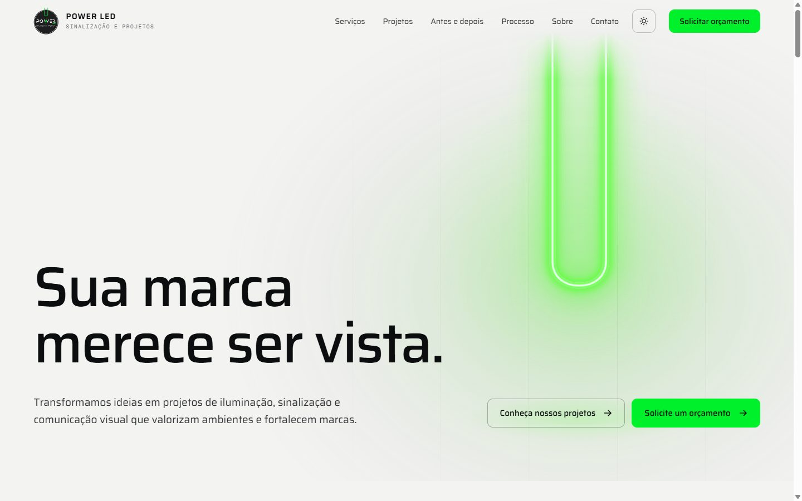
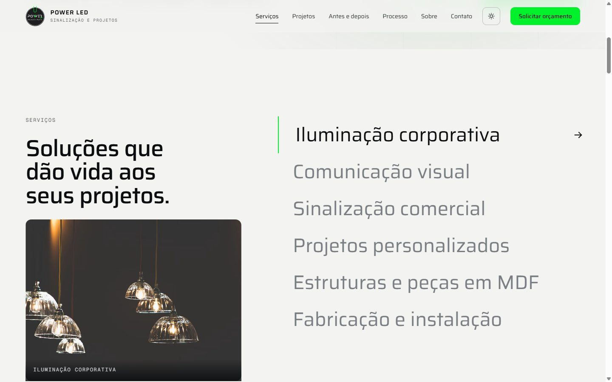
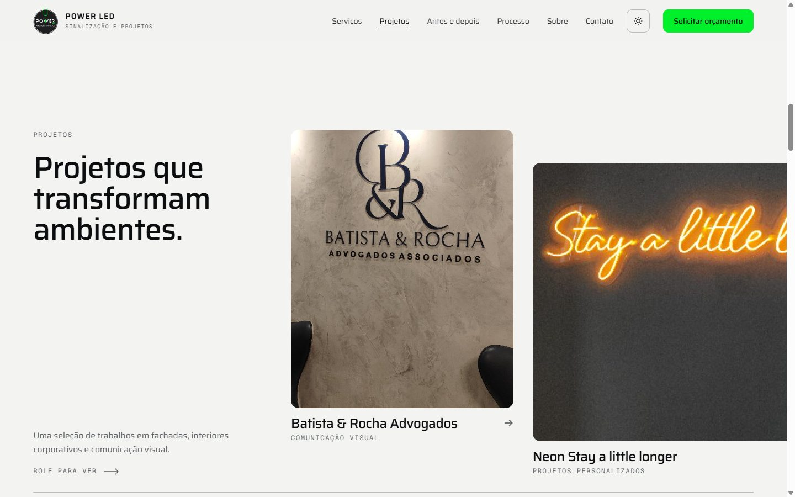
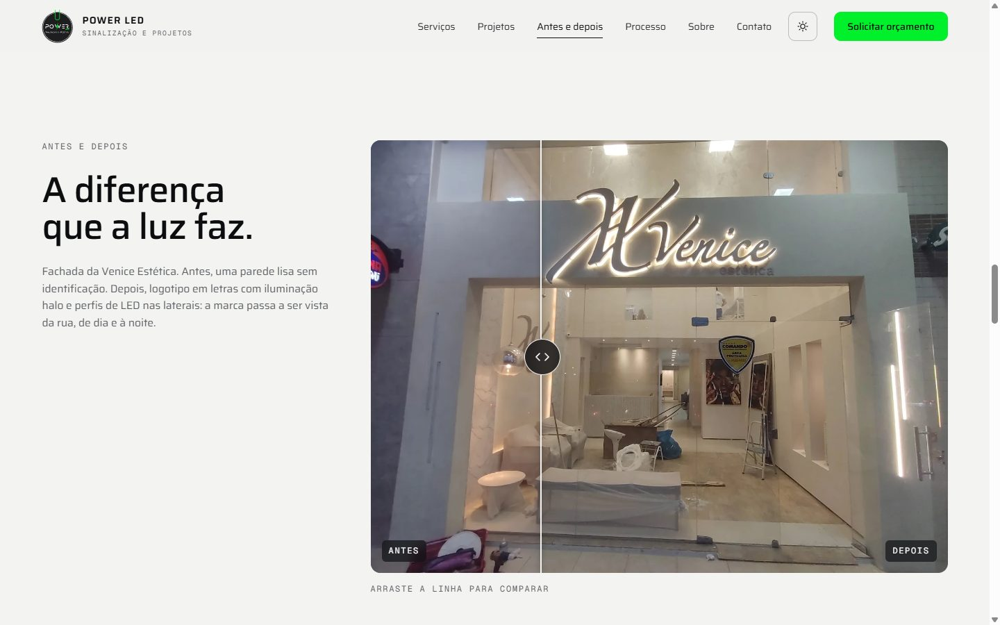
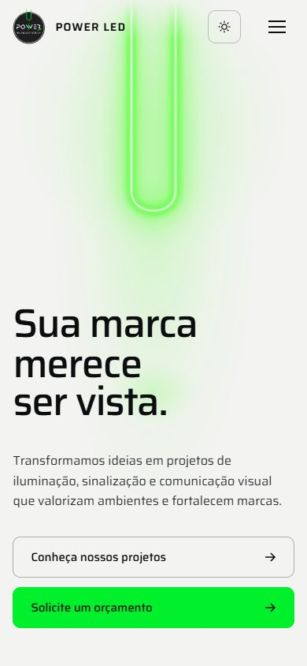

<div align="center">

# ⚡ POWER LED

### Sinalização e Projetos

Site institucional da **POWER LED**, empresa de iluminação, sinalização e comunicação visual.
Um site de uma página, escuro, com um neon em forma de U que acende na abertura e reage ao mouse.


<br>



</div>

<br>

## ✨ Destaques

| | |
|---|---|
| 💡 **Abertura com carregamento real** | O tubo do U acende conforme as imagens do site baixam. Quando tudo está pronto, o neon liga e a página se revela. |
| 🟢 **Neon interativo** | Passar o mouse ou tocar no U faz ele piscar, o halo crescer e o verde mudar de tom. |
| 🔌 **Seções que acendem** | Cada seção “liga” suavemente ao entrar na tela, como uma luz sendo acionada. |
| ↔️ **Antes e depois** | Comparador arrastável, leve no celular (a imagem não é redesenhada durante o arraste). |
| 🖼️ **Galeria de projetos** | Rolagem horizontal no desktop e arraste no celular, com fotos e vídeos reais de cada trabalho. |
| 🪟 **Modais animados** | Detalhes de serviços e projetos abrem e fecham com transição, com troca entre foto e vídeo. |
| 💬 **Orçamento pelo WhatsApp** | Todos os botões de orçamento abrem o WhatsApp com a mensagem pronta. |
| 🌗 **Tema claro e escuro** | O site abre no tema claro. O botão no topo alterna para o escuro, e a escolha fica salva no navegador. |
| ♿ **Acessível** | Navegação por teclado, foco visível e respeito ao “reduzir movimento” do sistema. |

<br>

## 📸 Telas

<table>
  <tr>
    <td width="50%"></td>
    <td width="50%"></td>
  </tr>
  <tr>
    <td width="50%"></td>
    <td width="50%" align="center"></td>
  </tr>
</table>

<br>

## 🚀 Como rodar

O site é um único `index.html`, sem dependências para instalar e sem etapa de build. Só precisa ser servido por HTTP (abrir o arquivo direto pelo navegador não carrega os vídeos e as fontes corretamente).

```bash
git clone https://github.com/thiagoferreirapy/powerled.git
cd powerled
python -m http.server 8080
```

Depois é só abrir **http://localhost:8080**.

Para publicar, qualquer hospedagem de arquivos estáticos serve: GitHub Pages, Netlify, Vercel ou a hospedagem da empresa.

<br>

## 🛠️ Como editar o conteúdo

Todo o conteúdo fica em listas no começo do `<script>` do `index.html`. Não é preciso mexer no HTML ou no CSS para atualizar o site.

| Onde | O que muda |
|---|---|
| `CONFIG` | WhatsApp, mensagem padrão, Instagram, e-mail, telefone, endereço e link do crédito no rodapé |
| `SERVICOS` | Os seis serviços: nome, textos, itens e foto |
| `PROJETOS` | A galeria: nome, categoria, descrição, formato do card e fotos/vídeos |
| `ANTES_DEPOIS` | Os comparadores: texto e as fotos de antes e depois |

### Adicionar um projeto

1. Coloque as fotos e os vídeos em `midia/`.
2. Copie uma linha de `PROJETOS` e troque os dados:

```js
{ nome:"Nome do cliente", cat:"Comunicação visual", desc:"O que foi feito.", formato:"p",
  fotos:["midia/foto.jpg", "midia/video.mp4"] }
```

- A **primeira mídia vira a capa**, então use uma foto.
- `formato`: `"l"` horizontal, `"p"` vertical ou `"s"` quadrado.
- Com mais de uma mídia, o detalhe do projeto ganha os botões **Foto / Vídeo**.

> **💡 Dica:** prefira imagens em `.webp` ou `.jpg` com até ~1600px de largura. A abertura espera todas as imagens carregarem, então arquivos muito pesados deixam a entrada mais lenta.

<br>

## 📁 Estrutura

```
powerled/
├── index.html      → o site inteiro (HTML, CSS e JavaScript)
├── midia/          → fotos e vídeos dos projetos reais
└── docs/           → imagens deste README
```

<br>

## ⚠️ Antes de publicar

Os contatos em `CONFIG` são **fictícios** (`(61) 99999-9999`, `contato@powerledsinalizacao.com.br`, `@powerled.sinalizacao`). Troque pelos dados reais da empresa, porque o botão de orçamento abre conversa com o número que estiver configurado.

<br>

## 🙌 Créditos

- **Projetos, fotos e vídeos de obras:** POWER LED
- **Fotos dos serviços:** [Unsplash](https://unsplash.com) (licença gratuita): pepe nero, Nick Fewings, Ginta Wang, Jonathan Borba e Minh Đức
- **Rolagem suave:** [Lenis](https://github.com/darkroomengineering/lenis)
- **Fontes:** [Saira](https://fonts.google.com/specimen/Saira) e [Geist Mono](https://fonts.google.com/specimen/Geist+Mono)

<div align="center">
<br>
<sub>Desenvolvido por <b>Nevoy</b></sub>
</div>
